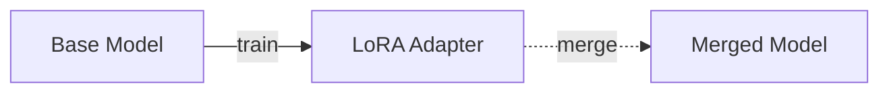
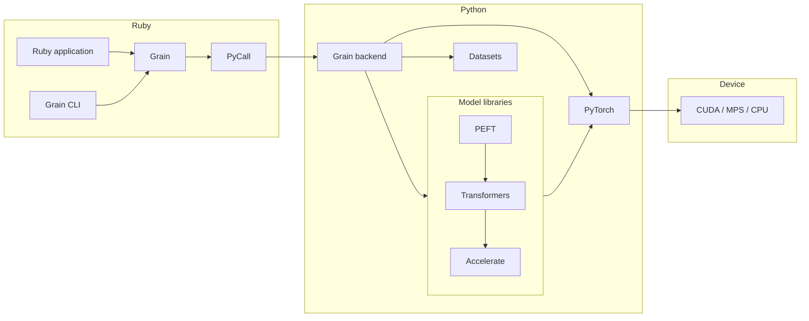

# Grain

Grain brings LoRA fine-tuning of large language models to Ruby. It provides an API and CLI that model the LoRA lifecycle,
while the heavy lifting is done by the Python ecosystem (PyTorch, Hugging Face Transformers, PEFT, Datasets, Accelerate) through PyCall.

## Features

- LoRA fine-tuning from JSONL files or Ruby Enumerables, in plain text, instruction, and chat formats
- Merging an adapter into its base model to produce a standalone model
- Generation and chat with a merged model, a Hugging Face model id, or an adapter on top of its base model
- Apple Silicon (MPS) as a first-class target, with CUDA and CPU auto-detected
- Validation loss, per-epoch checkpoints, and resuming
- A CLI for training, merging, and generation, and `grain doctor` to check the Python environment

## The model behind the API

LoRA keeps the base model weights $W_0$ frozen and learns a low-rank update of rank $r$:

```math
\begin{aligned}
W &= W_0 + \Delta W \\
\Delta W &\approx BA
\end{aligned}
```

$A$ and $B$ are small matrices that together typically hold well under 1% of the model's parameters. Training produces them; merging adds $BA$ back into $W_0$.
The API is the same shape:



Merging is optional: an adapter can also generate on top of its base model as is.

The [`rank:` option](#training-options) of `Grain::LoRA.train` is exactly the $r$ above.

## Requirements

- Ruby 3.0+
- Python 3.10+ with a shared libpython (static Python builds such as pyenv's default do not work; tested with Python 3.12)
- Ruby and Python built for the same CPU architecture. On Apple Silicon, an x86_64 Ruby running under Rosetta cannot load an arm64 libpython;
  a symbol error such as `_Py_NoneStruct` from `grain doctor` usually means this mismatch
- The Python packages `torch`, `transformers`, `peft`, `datasets`, and `accelerate`

## Installation

Add the gem to your Gemfile:

```console
$ bundle add grain
```

Set up a Python environment. With venv:

```console
$ python3 -m venv .venv
$ .venv/bin/pip install torch transformers peft datasets accelerate
```

Or with uv:

```console
$ uv venv
$ uv pip install torch transformers peft datasets accelerate
```

Note for pyenv users: PyCall needs a shared libpython, so install the interpreter with:

```console
$ PYTHON_CONFIGURE_OPTS="--enable-shared" pyenv install 3.12
```

When a `.venv` directory exists in the current directory, Grain uses it automatically. Set the `PYTHON` environment variable to override the interpreter,
then check the environment:

```console
$ bundle exec grain doctor
```

`grain doctor` reports the Python interpreter, each required package, and the available devices, and tells you what is missing.

## Usage

```ruby
require 'grain'

adapter = Grain::LoRA.train(
  model: 'Qwen/Qwen2.5-Coder-0.5B',
  dataset: 'ruby_answers.jsonl',
  rank: 8, # The LoRA rank r
  alpha: 16,
  dropout: 0.05,
  epochs: 2
)
adapter.save('./ruby-lora')

model = adapter.merge # W = W0 + B A
model.save('./ruby-model')
```

With these settings, training updates about 540 thousand of the model's 494 million parameters (0.11%).

Passing `eval_dataset:` holds a second dataset out of training and evaluates against it after every epoch.
The final validation loss lands in the adapter metadata, which is how you tell learning apart from memorizing:

```ruby
adapter = Grain::LoRA.train(model: ..., dataset: 'train.jsonl', eval_dataset: 'validation.jsonl')
adapter.metadata.dig('training', 'train_loss') # => 0.74
adapter.metadata.dig('training', 'eval_loss')  # => 0.91
```

`Grain::LoRA.train` returns a `Grain::LoRA::Adapter` that knows its `path`, `base_model`, `rank`, `alpha`, `dropout`, `target_modules`, and training `metadata`.
`adapter.merge` returns a `Grain::Model` with `path` and `base_model`. `save` moves the artifact to the given path; a destination produced by a previous `save` is replaced,
so scripts can be re-run, while any other existing path is refused.

### Generation

`Grain::Model#generate` produces a completion for a prompt. It uses greedy decoding, so the output is deterministic for a given model and prompt.
The model can be a merged model directory or a Hugging Face model id, which makes a before and after comparison one call each:

```ruby
prompt = "User: How do I reverse an array?\nAssistant:"

base = Grain::Model.new(path: 'Qwen/Qwen2.5-Coder-0.5B')
base.generate(prompt, max_new_tokens: 64)  # English prose from the base model

model = adapter.merge
model.generate(prompt, max_new_tokens: 64) # Ruby code from the fine-tuned model
```

Passing `temperature:` or `top_p:` switches decoding from greedy to sampling, which makes the model produce
different wording on each call. `seed:` makes sampled output reproducible again:

```ruby
model.generate(prompt, temperature: 0.7, top_p: 0.9, seed: 42)
```

`Grain::LoRA::Adapter#generate` runs the same generation with the adapter applied on top of its base model, without merging.
Since an adapter is a few MB against roughly a gigabyte for a merged model, this is the cheap way to try an adapter,
including one received from someone else:

```ruby
adapter = Grain::LoRA::Adapter.load('./ruby-lora')
adapter.generate(prompt, max_new_tokens: 64) # the same output, no merged model needed
```

The base model is read from the metadata recorded in the adapter directory, so it does not have to be given again.

`Grain::Model#chat` takes a transcript instead of a prompt and renders it with the model's own chat template, including the marker
that tells the model where its turn begins. Pass the whole transcript on every call to continue a conversation:

```ruby
chat_model = Grain::Model.new(path: 'Qwen/Qwen2.5-Coder-0.5B-Instruct')

chat_model.chat([
  {role: 'user', content: 'How do I reverse an array in Ruby?'},
  {role: 'assistant', content: '[1, 2, 3].reverse'},
  {role: 'user', content: 'And the last element?'}
])
# => "The last element of the array is `3`."
```

`Grain::LoRA::Adapter#chat` does the same with the adapter applied on top of its base model.

Reach for `#chat` when the model understands a chat template: an instruction-tuned model, or one fine-tuned on chat-format data.
A base model is a different matter. `Qwen/Qwen2.5-Coder-0.5B`, for instance, ships a chat template but was never instruction-tuned,
so prompting it in chat form produces poor output while `#generate` with a plain prompt works well.
The rule behind this also applies to choosing a dataset format: the prompt at inference should look like the text the model was trained on.

### Training options

| Option            | Default | Meaning                                                                                 |
| ----------------- | ------- | --------------------------------------------------------------------------------------- |
| `rank:`           | `8`     | LoRA rank $r$, the rank of the low-rank update $BA$                                     |
| `alpha:`          | `16`    | LoRA scaling factor (`lora_alpha` in PEFT)                                              |
| `dropout:`        | `0.05`  | LoRA dropout (`lora_dropout` in PEFT)                                                   |
| `target_modules:` | `nil`   | Modules to adapt, e.g. `%w(q_proj v_proj)`. `nil` uses PEFT's per-architecture defaults |
| `epochs:`         | `3`     | Training epochs                                                                         |
| `batch_size:`     | `4`     | Per-device batch size                                                                   |
| `learning_rate:`  | `2e-4`  | Learning rate                                                                           |
| `max_length:`     | `512`   | Max token length per example                                                            |
| `eval_dataset:`   | `nil`   | Held-out dataset, in the same format as `dataset:`. Enables per-epoch evaluation        |
| `checkpoints:`    | `false` | Save a checkpoint after every epoch, so a long run can be resumed                       |
| `resume:`         | `false` | Resume from the last checkpoint in `output_dir`, which must be given explicitly         |
| `output_dir:`     | `nil`   | Adapter output directory. `nil` uses a temporary directory; `save` moves it             |
| `device:`         | `:auto` | `:auto`, `:cuda`, `:mps`, or `:cpu`                                                     |

### Dataset

Each line of a JSONL dataset is a JSON object in one of three shapes. The simplest has a `text` key:

```json
{"text":"User: How do I reverse an array?\nAssistant: [1, 2, 3].reverse\n# => [3, 2, 1]"}
{"text":"User: How do I get the length of a string?\nAssistant: 'hello'.length\n# => 5"}
```

Lines with `instruction`/`output` keys (and an optional `input`) are also accepted and rendered into a text prompt automatically:

```json
{"instruction":"Explain what Array#map does","output":"It returns a new array with the block applied to each element."}
```

Chat transcripts are accepted as a `messages` array. These are rendered with the tokenizer's own chat template,
so the conversation is formatted the way the model expects:

```json
{"messages":[{"role":"user","content":"How do I reverse an array?"},{"role":"assistant","content":"[1, 2, 3].reverse"}]}
```

`dataset:` also accepts any Enumerable of record Hashes in the same three shapes, so data built in Ruby needs no file of its own:

```ruby
Grain::LoRA.train(
  model: 'Qwen/Qwen2.5-Coder-0.5B',
  dataset: Article.published.map { |article| {text: article.body} }
)
```

A useful fine-tuning dataset teaches the model something it does not already do. The bundled `examples/ruby_answers.jsonl` teaches the model to answer programming questions with Ruby code only:
the base model replies with an English paragraph, while the fine-tuned model replies with a bare snippet and a `# =>` comment. The effect is visible at a glance in any spoken language,
because the difference is the shape of the output rather than its wording. See `examples/train_and_merge.rb` for a runnable example.

### Devices and Apple Silicon

The device is auto-detected with CUDA > MPS > CPU priority:

```ruby
Grain.device # => :mps
```

Apple Silicon Macs (M1 and later) are a first-class target: small models such as `Qwen/Qwen2.5-Coder-0.5B` fine-tune on MPS.
Training uses float32 on MPS (half precision there is numerically fragile), bfloat16 on capable CUDA GPUs, and `PYTORCH_ENABLE_MPS_FALLBACK=1` is set automatically for
operators MPS does not implement. Merging always runs on CPU, which is the memory-safest place for it.

### Environment check

```ruby
Grain.check # => a Hash describing Python, packages, and devices
```

```console
$ grain doctor
Ruby:         4.0.6 (grain 0.1.0)
Python:       3.12.13 (/path/to/.venv/bin/python)
torch:        OK 2.13.0
transformers: OK 5.15.0
peft:         OK 0.20.0
datasets:     OK 5.0.1
accelerate:   OK 1.14.0
Device:       mps (CUDA: no, MPS: yes)
Status:       OK
```

### Errors

Python exceptions never surface raw. They are translated into `Grain::DependencyError`, `Grain::ModelLoadError`, `Grain::DatasetError`, `Grain::TrainingError`,
`Grain::MergeError`, or `Grain::GenerationError`, and the original Python error (with its traceback) stays reachable via `error.cause`.
Invalid arguments are rejected in Ruby with `Grain::ConfigurationError` before the backend is called.

## CLI

The CLI covers the core of the lifecycle: training, merging, and generation from a prompt.
Validation datasets, checkpoints, and chat are available from the Ruby API only.

```console
$ grain lora train \
    --model Qwen/Qwen2.5-Coder-0.5B \
    --dataset ruby_answers.jsonl \
    --rank 8 \
    --epochs 2 \
    --output ruby-lora
```

```console
$ grain lora merge \
    --adapter ruby-lora \
    --output ruby-model
```

`lora merge` reads the base model from the metadata recorded in the adapter directory; pass `--model` to override it (for example, for adapters produced by plain PEFT).

```console
$ grain generate \
    --model ruby-model \
    --prompt $'User: How do I reverse an array?\nAssistant:'
```

`--model` also accepts a Hugging Face model id, so the same command shows the base model's output for comparison.
`--temperature`, `--top-p`, and `--seed` are the CLI equivalents of the sampling options above.
Passing `--adapter` instead generates with the adapter applied on top of its base model, without merging:

```console
$ grain generate \
    --adapter ruby-lora \
    --prompt $'User: How do I reverse an array?\nAssistant:'
```

`grain doctor` and `grain version` are also available.

## Architecture

The Ruby side is a thin layer. Each call goes through PyCall to the Grain backend, a Python package bundled with the gem and not a public API,
which drives the Python libraries that do the actual work on the selected device:



Grain CLI, Grain, and the Grain backend ship in the grain gem.
Arrows show what each part uses at run time, not package dependencies.

Grain does not reimplement Transformers or LoRA in Ruby, and it does not hide what fine-tuning is. It hides Python plumbing, not concepts.

For the same reason, adapters are saved and loaded by PEFT itself. An adapter directory is a standard PEFT adapter (`adapter_config.json` and `adapter_model.safetensors`) with
Grain's own metadata in `grain.json` alongside, so adapters trained with Grain load in Python with PEFT's `PeftModel.from_pretrained`, and `Grain::LoRA::Adapter.load` accepts
adapters produced by plain PEFT.

## Process model and limitations

Grain is designed for CLI, Rake tasks, batch jobs, and offline experiments. It is not designed to run inside web application workers:

- PyCall embeds a single Python interpreter in the Ruby process. Backend calls hold both the Python GIL and Ruby's GVL, so every Ruby thread in the process stalls until the call returns.
- Do not fork the process after the backend has been initialized (Spring, Puma workers, and so on). The backend loads lazily, so forking before the first call is safe.
- Training keeps no checkpoints unless `checkpoints: true` is passed, so by default a crash during training loses that run's progress.

## Development

After checking out the repo, run `bin/setup` to install dependencies. Then run `bundle exec rake` for the unit tests and RuboCop. Unit tests never load PyCall or Python;
`Grain::Backend::Python` is replaced by a fake at the backend seam (`Grain.backend=`).

An integration test runs a real fine-tune with a tiny model on CPU. It needs a prepared Python environment and network access for the first model download:

```console
$ GRAIN_INTEGRATION=1 bundle exec rake test:integration
```

The same tests run weekly on CI, and on demand through the Integration workflow.

## Name

A model is hundreds of millions or billions of scalar parameters, and LoRA trains only a small fraction of them.
Each of those parameters is a grain, the smallest particle of the whole. A grain is also a traditional unit of weight for gems
(a pearl grain is a quarter carat), which suits a Ruby gem whose subject is model weights.

## License

The gem is available as open source under the terms of the [MIT License](https://opensource.org/licenses/MIT).
